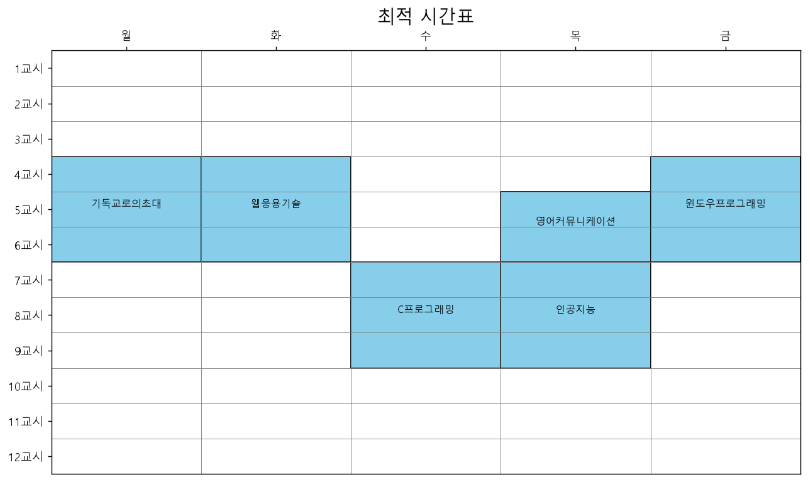

# 시간표 최적화 · Simulated Annealing

> 15~18학점 안에서 **공강은 줄이고 하루 수업은 고르게** 되는 대학 시간표를 담금질 기법으로 찾는 프로그램

- **기간**: 2025.09 · 개인 프로젝트
- **기술**: Python · pandas · matplotlib



<sub>저장소의 강의 데이터(25과목)로 실제로 돌린 결과입니다. 교수명은 가렸습니다.</sub>

## 결과

같은 데이터로 30번 돌려 비교했습니다 (평가 점수, 낮을수록 좋음).

| | 평균 점수 | 점수 0 (공강·과밀 없음) |
| --- | --- | --- |
| 무작위 초기 시간표 | 8.43 | - |
| 담금질 후 | **0.80** | **24 / 30회** |

## 어떻게 동작하나

1. **초기 상태**: 시간이 겹치지 않게 강의를 무작위로 골라 15학점 이상, 18학점 이하를 채웁니다.
2. **평가 함수**: 요일마다 수업 사이 빈 교시 수(공강)와, 하루 수업이 5교시 넘게 퍼진 만큼(피로도)을 더합니다.
3. **이웃 상태**: 강의 하나를 빼고, 시간이 겹치지 않는 다른 강의로 바꿉니다.
4. **담금질**: 더 나은 시간표는 바로 받아들이고, 더 나쁜 시간표도 `exp(-Δ/T)` 확률로 받아들입니다. 온도가 높은 초반에는 나쁜 해도 자주 받아들여 지역 최솟값에서 빠져나오고, 온도를 0.95배씩 낮추며 1,000번 반복합니다.

| 파일 | 역할 |
| --- | --- |
| `load_data.py` | 엑셀 강의표 읽기 |
| `state_and_evaluation.py` | 초기 상태, 평가 함수, 이웃 상태 |
| `simulated_annealing.py` | 담금질 반복 |
| `visualize.py` | 결과 시간표 그리기 |

## 실행

```bash
pip install pandas openpyxl matplotlib
python main.py
```

`main.py`의 `filepath`를 `scheduleTable.xlsx`가 있는 경로로 바꾼 뒤 실행합니다.
